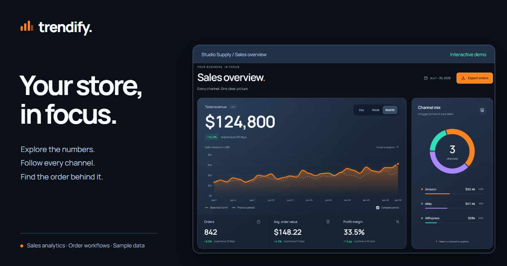

# Trendify

A commerce analytics workspace for the fictional **Studio Supply** store. Track sales across Amazon, eBay, and AliExpress, explore revenue, and find the order behind a number.



[Live demo](https://shevdevworks.github.io/trendify/) · [Desktop preview](portfolio/desktop.png) · [Mobile preview](portfolio/mobile.png) · [Walkthrough video](portfolio/walkthrough.mp4)

This is a **frontend portfolio project** with illustrative data for June 2026. It has no backend, authentication, payment processing, or marketplace connections. The channel controls change the local view; they do not connect or disconnect real accounts.

## The experience

- A revenue-first midnight workspace with a vivid orange accent, violet and mint channel colors, self-hosted Manrope, and custom SVG product illustrations.
- Revenue, orders, average order value, and revenue-weighted margin derived from the same selected channels.
- An orchestrated entrance: the revenue line draws across its canvas as the totals count up. Period and channel changes morph the existing curve, including transitions between different point counts.
- Sliding selection indicators, animated order rows, channel previews on hover or keyboard focus, and an order drawer with coordinated entrance and exit transitions. Motion uses native browser APIs, with no animation dependency.
- Compare the selected period against the preceding period, or explore individual channels through the donut legend.
- Chart values accessible by mouse, touch, or keyboard: focus the revenue chart, then use Left/Right, Home/End, or Escape.
- Search recent orders by product, ID, or channel; combine the search with a fulfilment status; browse pages and open order details.
- CSV export of **all matching sample orders**, including matches on other pages. Exports use ISO dates, numeric USD amounts, proper quoting, and a UTF-8 BOM.
- Accessible modal dialogs with focus wrapping, Escape dismissal, backdrop dismissal, and focus restoration.
- Responsive layouts from 320px, readable mobile form inputs, empty and retry states, and support for reduced motion.

## Run locally

No dependency installation or build step is needed. Serve the directory over HTTP so the browser can load ES modules:

```bash
python -m http.server 8080 --bind 127.0.0.1
```

Open **http://127.0.0.1:8080**. Any other static server also works. With Node installed, `npm run dev` runs the same Python command. In PowerShell environments that block `npm.ps1`, use `npm.cmd run dev`.

## Tests

Requires a recent Node.js version with the built-in test runner (Node 20+).

```bash
npm test
# PowerShell alternative
npm.cmd test
```

The 11 dependency-free tests cover cent-accurate allocation, matching daily/weekly/monthly revenue, every channel-selection combination, empty views, percentage-point margin changes, share rounding, search/status intersections, CSV output, and rejected invalid periods.

The UI was also checked in Chromium at 320, 390, 560, 768, 1024, 1280, 1440, and 1920px, including keyboard dialogs, chart controls, rapid period switches, filtered downloads, reduced motion, and recovery from an injected loading failure. This is not a substitute for a full cross-browser or assistive-technology audit.

## Data and interaction model

`data.js` constructs deterministic per-channel daily data. Day and week revenue are slices of the same June dataset. Allocation happens in integer cents (and whole units for orders), so rounding does not lose revenue. The June comparison uses the preceding 30 days; week and day use their preceding equal-length periods.

`model.js` contains pure derivation and filtering functions. The UI displays aggregate metrics separately from a clearly labelled recent-order sample. Search and status filters affect the order list and export; channel filters affect the entire dashboard. Pagination only changes which matching orders are visible.

`app.js` owns state and ignores stale asynchronous responses. Period changes keep the previous view visible while loading, and a failed refresh restores the previous selection. `charts.js` retains chart elements between updates and observes container resizing without replaying entrance animations.

`motion.js` coordinates Web Animations API transitions, measures row positions before list updates, and keeps dialogs modal until their closing animation completes. The interface shows final values immediately when the system's reduced-motion preference is enabled.

## Files

```text
index.html              Semantic layout, icons, dialogs, and sharing metadata
css/main.css            Theme, component styles, motion, and responsive layouts
js/app.js               State, events, loading, dialogs, and export
js/model.js             Pure calculations, order filters, and CSV serialization
js/data.js              Deterministic sample data and simulated async boundary
js/charts.js            Stateful SVG line and donut charts
js/ui.js                Metrics, orders, detail panels, toasts, and loading states
js/motion.js            Entrances, selection tracks, list transitions, and dialogs
js/products.js          Original SVG product illustrations at any display size
js/format.js            Shared colors, formatting, and HTML escaping
assets/fonts/           Self-hosted Manrope and its OFL license
tests/model.test.js      Calculation and export regression tests
portfolio/              Screenshots and an interface walkthrough
og-dashboard-v4.png     1200 × 630 sharing cover
scripts/social-cover.html  Editable sharing-cover source
```

Manrope is distributed under the SIL Open Font License; see `assets/fonts/OFL.txt`.
