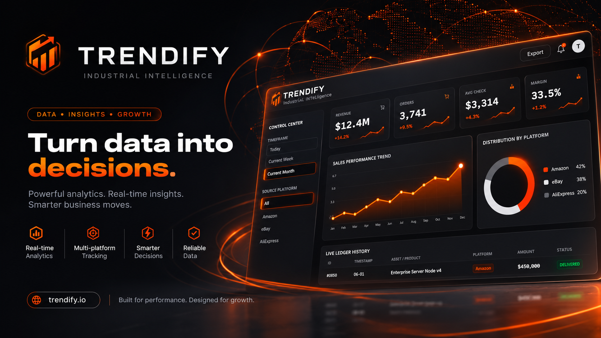

# Trendify

**Industrial-grade analytics dashboard concept** — a dark, neon-accented control center for tracking revenue, orders, and marketplace performance across Amazon, eBay, and AliExpress.

Built with zero frameworks and zero build tooling: just semantic HTML, hand-written CSS, and vanilla ES modules. Every chart on the page is rendered as raw SVG at runtime — no charting library involved.



**Live demo:** https://shevdevworks.github.io/trendify/

> **Note:** This is a front-end portfolio/demo project, not a production app. It has no real backend or marketplace integrations — all data comes from a mock dataset in [`js/data.js`](js/data.js) behind a simulated network call. The goal is to showcase front-end engineering skills: hand-rolled SVG data visualization, state-driven UI architecture, and responsive design, all without relying on any framework or charting library.

## Features

- **KPI grid** — Revenue, Orders, Avg Check, and Margin, each with a period-over-period trend indicator.
- **Sales trend chart** — a custom cubic-bezier SVG line chart with gridlines, axis labels, and a cursor/touch-following tooltip.
- **Platform distribution chart** — a hand-rolled SVG donut chart with an inline legend.
- **Live filtering** — switch timeframe (Day / Week / Month), isolate a single source platform, or toggle individual data streams on/off. KPIs and charts recompute instantly from cached data with no extra network round-trip.
- **CSV export** — download the currently filtered Live Ledger rows as a `.csv` file.
- **Resilient data loading** — skeleton loaders while fetching, a recoverable error panel with a retry action on failure, and dispatch-ID based race-condition guarding so out-of-order responses never clobber the UI.
- **Responsive layout** — a fixed sidebar on desktop collapses into a swipeable drawer on mobile, and the ledger table reflows into stacked cards below 768px.
- **Toast notification system** for stream/connection status changes.

## Tech Stack

- Plain HTML5 + CSS3 (custom properties, grid/flexbox, no preprocessor)
- Vanilla JavaScript (ES modules, no bundler, no dependencies)
- Native SVG DOM APIs for all data visualization

## Getting Started

Because the app is loaded via `<script type="module">`, it needs to be served over `http://` rather than opened directly as a `file://` path (browsers block ES module loading under `file://`).

Pick any static file server, for example:

```bash
# Node
npx serve .

# Python
python -m http.server 8080
```

Then open the printed local URL in your browser. Alternatively, use an editor extension like VS Code's *Live Server*.

## Project Structure

```
trendify/
├── index.html          # Page markup and metadata (SEO / Open Graph / Twitter cards)
├── favicon.svg
├── og-image.png
├── css/
│   └── main.css         # Full visual theme, layout, and responsive rules
└── js/
    ├── app.js           # App state, event wiring, and derived-data orchestration
    ├── data.js          # Mock dataset + simulated async fetch
    ├── charts.js         # SVG line & donut chart rendering
    └── ui.js            # DOM rendering: KPIs, table, toasts, skeletons, error state
```

## How It Works

`data.js` simulates a backend by resolving a mock dataset after a short delay. `app.js` caches whatever it receives and derives every on-screen value from that single cached snapshot plus the current filter state — so switching timeframe triggers a re-fetch, while toggling a platform or a data stream only recomputes and re-renders locally, with no network cost.

Filtering out a platform scales revenue, orders, and the trend chart by that platform's share of the total (via `platformDistribution`), and re-normalizes the donut chart so the remaining active platforms still sum to 100%. The Live Ledger table and CSV export both filter through the same `filterTransactions` helper in `ui.js`, so the visible rows and the exported rows are always guaranteed to match.
